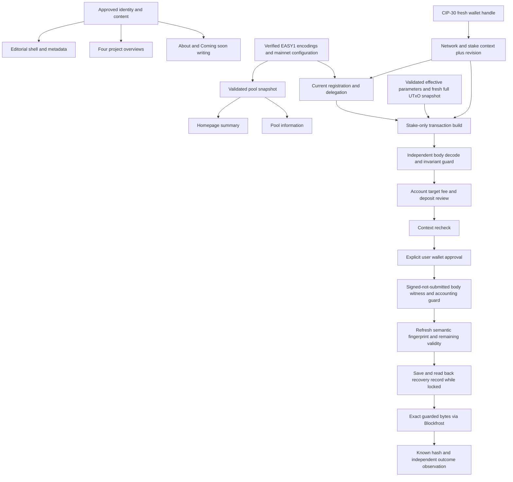

# EASY1 brand hub — component layout

Version: 1.0, 2026-10-14. Read with locked `SPEC.md` version 1.0. Locked implementation layout, still a best-effort design with empirical implementation gates. Review may expose additional dependencies. No new on-chain component or backend service is introduced.

## Components, inputs and state

| Component / proposed location | Inputs and why | Owned state / mutability | Operations and assumptions |
|---|---|---|---|
| Site configuration, `src/lib/site/config.ts` | Canonical URL, approved social links, route map, verified pool encodings, fee/validity bounds and explicit mainnet preset: each controls a public destination/transaction identity. | Build-time configuration, immutable during a deployed build. Pool operational eligibility is separately mutable. No governance configuration. | Validate identity/network; supply shared metadata/nav/pool target. Configuration presence alone does not prove pool identity. |
| Content catalogue, `src/lib/site/projects.ts` or dedicated content modules | Four project IDs/slugs, summaries, capability status, creator/handover relationship, destinations, official icons/captures and provenance: keeps copy and links consistent across pages. | Versioned content, changes by reviewed source edit; not live user state. | Enumerate cards, resolve known slugs, supply static overview content; unknown ID returns not-found. Cardano Dev Skills has originated/transferred attribution, not current ownership. |
| Editorial shell, `src/app/layout.tsx`, `globals.css`, site navigation/footer | Tokens, licensed font/brand assets, content routes and page metadata: reproduce the approved visual direction on every page. | Mobile-menu open/closed, ephemeral mutable UI state. | Keyboard/touch navigation, current page indicators, focus return and reduced motion. Server-render stable identity; never inspect wallets here. |
| Homepage, `src/app/page.tsx` plus section components | Approved content, four portfolio entries and normalized pool snapshot: compose the ordered sections without owning separate provider logic. | No persistent user state; client fragment-compatibility bridge only. | Render project/pool/story/writing sections and map approved old fragments. Unknown fragment cannot trigger a transaction. |
| Project overview route, proposed `src/app/projects/[slug]/page.tsx` | Catalogue entry, official imagery, role attribution and outward URL: make each product understandable within EASY1. | No wallet/session state. | Generate four known routes, show independent destination, quiet Pool link and authorship. Escape/render typed text rather than arbitrary HTML. |
| About route, `src/app/about/page.tsx` | Approved biography, role and genuine portrait: demonstrate the creator relationship. | Build-time content. Portrait availability is a release input. | Render confirmed journey and handover; no fabricated dates/client history or public draft placeholder. |
| Writing index, `src/app/blog/page.tsx` | Three titles with status `coming-soon` and optional future published metadata: distinguish ideas from real writing. | Versioned content entries. | Coming-soon entries render as non-linked cards; published entries require approved body/date/author before any route or sitemap entry. Review sample is separate from the app. |
| Article layout component | Approved article blocks, title, author/date when a real article exists: standardize future reading experience. | Render-only; no launch article body. | Render safe text/code/image blocks. No public `article-layout` sample route or lorem ipsum fixture. No CMS/MDX dependency needed for the initial scaffold. |
| Pool data adapter, `src/lib/site/blockfrost.ts` | Explicit mainnet endpoint, intentionally provisioned project identifier, verified pool ID and cache policy: obtain one trusted indexed data source; indexed views are not an atomic ledger snapshot. | Cached `{status, values, observedAt}` snapshot, replaceable on successful validated read. Unknown/stale values are distinct from zero. | GET pool/epoch data, validate schema/units and build field-level output. Cache time is when the snapshot was actually fetched, not render time. Never substitute sample facts. |
| Pool page, `src/app/pool/page.tsx` | Shared normalized snapshot, confirmed target identity and client wallet island: compose informational and action sections. | No provider credentials beyond deliberate client configuration. | Server render pool facts, explain delegation and mount the wallet flow only here. Data failure must not erase readable page content. |
| Wallet session provider / hook, proposed `src/lib/site/wallet.ts` | CIP-30 discovery, fresh `enable` API, mainnet expectation and current reward/change-address context: establish the account that will sign. | `{walletId, api, networkId, stakeCredential, stakeAddress, revision, phase}`, ephemeral mutable state. Remembered wallet ID only if chosen; no address/handle persistence; only the separate minimal recovery record survives reload. | Connect/disconnect, serialized rechecks on focus/visibility/visible poll, update handle and revision, invalidate assessments/reviews, discard old-revision asynchronous results. |
| Stake assessment, `staking.ts` separated from voting logic | Verified stake address, mainnet provider and pool target: find registration and current pool delegation; use the explicit SPEC transport matrix/public identifier. | `{revision, registrationState, stakeState, observedAt}`, ephemeral snapshot. An unknown registration state is not false. | Read account state and classify EASY1/other/none, with independent unknown/error state. Does not promote/compare DRep identities or infer registration from transport failure. |
| Delegation builder/reviewer, proposed stake-only module | Explicit mainnet SDK preset, fresh wallet context, actual registration/protocol parameters and EASY1 target: construct only the allowed operation. | `{revision, unsignedBytes, decodedReview, bodyIdentity}`, ephemeral, invalidated when relevant inputs change. | Lazy-load pinned Evolution SDK, protect reference-script outputs, build stake registration/delegation, independently decode and enforce body invariants before signing. No vote/reward/mint/script action. |
| Submission controller | Reviewed body and same-revision enabled wallet handle: ensure the user's reviewed transaction is the one signed/submitted. | `building → review → signing → signed-not-submitted → submitting → submitted/unknown → confirmed` with explicit cancellation/error paths; known ID/input references/validity saved in the minimal local RecoveryRecord; signed bytes remain session-only. | One origin-wide locked in-flight action while lock/storage are retained; best-effort duplicate suppression, not crash-durable exactly-once. No automatic resubmission/rebuild. Known body ID precedes submit, post-sign witness/body/context/eligibility checks precede the outward call, and the shared recovery record prevents reload/tab repeats during index lag. |
| Migration/metadata layer | Reviewed route-response map, production origin, actual launch pages and media assets: preserve meaningful destinations and accurate discovery. | Build-time route/metadata tables. | HTTP redirects/retirements, real 404, canonical tags, social cards, sitemap and brand media. Never deliver legacy API HTML redirects or expose preview/sample pages. |

## State ownership and concurrency

Wallet state has one owner. No section maintains an independent enabled handle or chosen address. Each connect/account/network change advances `revision`; every assessment/build result carries its starting revision, and an obsolete result is ignored. Building/signing/submitting share one in-flight lock. Rechecks are serialized; a hidden tab does not poll. Returning from the extension rechecks the enabled API rather than trusting an old handle.

Disconnect clears UI/remembered choice and invalidates future work. A signed transaction already submitted cannot be cancelled by disconnect; a known outcome and retained RecoveryRecord stay described accurately without being attached to a newly selected account. Only positively known unattempted bytes may be discarded without chain reconciliation; losing browser storage is the explicit recovery limitation.

Registration is `known-registered | known-unregistered | unknown`, separate from whether a pool is selected. Delegation cannot be enabled for unknown registration, unsupported credential/network, failed target identity validation, stale revision or a malformed provider response. An already-EASY1 account does not need another delegation. A retained origin-wide pending intent also blocks a new build until safely reconciled; no absent local record proves there was never an intent. Credential binding follows SPEC W3, never the first reward address. The supported credential scope is ordinary key credentials; a script/multisig capability not supported by the verified wallet/SDK path produces a limitation, not a guessed transaction.

## Derivation and dependency graph

All configuration precedes its consumers; no application value is derived from its own transaction/hash. No state token, validator address or minting policy is required. The Foundation project is linked content, not a runtime dependency of staking.

## Initialization and authorization sequence

1. Apply the locked route/content/technical defaults. Giovanni supplies/approves the portrait; clean dependency and target-identity checks must produce evidence before their respective gates close.
2. Materialize the pinned application in an isolated implementation branch/copy. Bring in the approved brand/content inputs through an explicit reviewed base snapshot; build the release package from the reviewed application-only export, with explicit runtime allowlist and negative package/image scans. Keep the existing main checkout untouched during isolated implementation; no startup path executes its opaque api.js.
3. Install the lockfile dependencies and prove build/lint in that application context. Import the licensed brand assets and configure route/content tables; do not regenerate identity geometry.
4. Validate both EASY1 encodings and its observed mainnet identity. Provision the one intentionally public browser/mainnet project identifier through the existing deployment configuration. It also serves server pool reads; no private server key is exposed and no credential values appear in product docs/evidence. See SPEC transport matrix; failure never selects another key/provider.
5. Wire static routes, metadata and server pool snapshots. Start the reviewed built artifact with Next's safe startup, independent of main's scripts.
6. Mount wallet discovery on `/pool` only. No wallet is enabled until the visitor chooses to connect. Establish revision/network/stake context and obtain a current assessment.
7. User initiates delegation under the origin lock, reviews the independently inspected body/accounting and approves signing in the wallet within the specified window. The wallet owns key access; the site never holds a seed/private key. Refresh the full semantic fingerprint and remaining validity after signing, validate final witnesses/fees and save/read back recovery state before guarded Blockfrost submission. Observe status; no hidden helper retries.
8. Before release, run the offline/test-ledger and served-artifact checks, verify the real portrait and reviewed route migration map, then provide a concrete release candidate. Publishing is separately directed; review-server authorization is not production-deployment authorization.

## Runtime shapes

| Operation | Components reached | Boundary / failure behavior |
|---|---|---|
| Read homepage | Shell, catalogue, writing metadata, pool data | Provider failure leaves content and onward paths available; unknown values stay unknown. No wallet API/SDK load. |
| Read project overview | Shell, catalogue, imagery | Unknown slug is 404; onward destination is explicit; Foundation attribution remains visible. |
| Read About/Blog | Shell, approved content | Missing release portrait/content must be caught before publication; Coming soon has no unwritten-article destination. |
| Connect wallet | Wallet session, credential/network validation, assessment | Permission rejection/network mismatch/provider failure yields recoverable state, not guessed registration. |
| Change account/network | Wallet recheck, session revision, dependent invalidation | No old handle/body/result may authorize the new context. |
| Delegate stake | Session, assessment, provider/SDK build, body guard, review, signing, submission, observer | Transaction is allowed only after W1–W8 gates; unsafe body/ref script input or unknown context is rejected before signing. |
| Confirm submission | Observer, known hash, fresh assessment | Provider lag is pending/unknown, not a new signing request. |
| Legacy URL | Migration table, retirement page/JSON or redirect | Uses reviewed HTTP response semantics without recreating excluded tools. |

## Inherited versus site-owned guarantees

| Guarantee | Provider | What the site must still establish |
|---|---|---|
| Browser wallet bridge methods/approval interface | CIP-30 wallet implementation | Check method availability, network/context freshness, failure codes and user approval path; standard conformance is not universal wallet behavior. |
| Keys remain with wallet | Wallet | Never collect a seed/private key or add server-side signing. Do not log wallet payloads. |
| Accepted transaction changes ledger state | Cardano ledger | Build the right transaction, prove certificate effects with an independent oracle and report submission/confirmation accurately. SDK helper naming is not ledger evidence. |
| Blockfrost documented fields | Provider/schema | Validate actual responses, units, missing values, credentials and cache age. Response schema documentation is not a successful live read. |
| App routing/cache primitives | Next.js | Specify route statuses, configure cache/timestamps correctly and test the built artifact. Static review-file navigation is not application routing evidence. |
| Typeface use | Bundled Poppins SIL OFL licence | Carry the licence/source attribution and avoid introducing a font service. |
| Current product capabilities | Reviewed product sites | Recheck launch claims and roadmap distinctions. User-provided founder attribution remains labelled by its actual evidence source. |
| Accessibility and responsive behavior | Site implementation | Browser/keyboard/contrast/text-zoom checks on the production artifact, not confidence from the static preview. |

## Evidence still needed before implementation/release claims

A genuine portrait asset; clean locked dependency reproduction; release revalidation of the independently corroborated EASY1 identity; source/fixture validation of pinned SDK certificate effects; current-account/race/error probes; independent test-ledger acceptance preserving voting delegation; and checks against the actual release artifact. These are concrete dependency gates, not claims that the current design preview already satisfies them.

## Pass-1 refinements: instantiated safeguards

- **PoolEligibility**, separate from five-minute marketing data: uncached current registered/retirement state, epoch and `observedAt`; 30-second maximum age for build/pre-sign/post-sign gates. Interpret latest effective updates rather than historical retirement hashes. Unknown/ineligible blocks transactions. Ticker does not replace pool hash identity.
- **CredentialBinding**: fresh mainnet base/change address → key stake credential A → deduplicated matching reward address when supplied. Nonempty no-match and enterprise/pointer/script contexts fail closed. Empty reward list can use derived A only with independently known registration; no first-entry selection or invented registration. These values are part of the session revision/fingerprint.
- **BodyGuard / FeeGuard**: tags 2, 7+2 or 11 only, per registration state; validate credential, target and deposit, reject all other effects. Independent current linear-fee calculation plus 10,000-lovelace tolerance and 500,000-lovelace absolute cap; exact final signed size/witnesses are checked again. Construction observes a validated tip and `invalidHereafter = tip + 600` slots. Never guess fees, deposits, slot configuration or witness counts.
- **SignedNotSubmitted**: verify/assemble wallet witnesses without changing the reviewed body bytes/hash, then await the complete fresh semantic fingerprint (wallet, assessment, parameters, selected inputs and eligibility). An observed changed context invalidates this signed candidate. The fixed reviewed credential still constrains the bytes if an external switch is unobservable; no atomic wallet-account lock is inherited from CIP-30.
- **RecoveryRecord**, one localStorage record per browser origin: version/network/pool, independently derived transaction ID, finite upper-bound slot, original input references, creation time and outcome stage. No addresses, API handle, CBOR/witness bytes or secrets persist. The record is saved before invoking submission, shared across tabs, retained until confirmed/reconciled or proven expired/unincluded with coherent ledger input evidence. An index 404 or elapsed clock alone never clears it. Its prior account can be derived from the indexed body's certificate when available, without persisting an address. Browser crash/eviction/rollback, private-session end, user-cleared data and cross-device activity are outside the retained-storage conditional guarantee. A localStorage readback is not durable acknowledgement.
- **OriginDelegationLock**: `navigator.locks` serializes decision/build/sign/initial submit and every deliberate same-byte retry, rereading RecoveryRecord while held. A second tab/changed wallet cannot start another delegation while the record is unresolved. Lock/storage unavailable means fail closed with an explicit supported-environment/manual-wallet path, not a non-atomic lease fallback. Pending record remains after releasing the initial lock; status checks never sign or build. A deliberate same-byte retry reacquires the lock and passes the full post-sign/validity barrier.
- **Outcome reconciliation**: positive indexed inclusion plus affected-credential delegation observation can clear a confirmed record. Negative recovery needs a post-validity coherent ledger point and original input-state proof; if the chosen provider cannot supply that, safe rebuild is unavailable. Show status checking/manual-wallet guidance. Same-byte deliberate retry exists only while the original signed bytes remain in memory and valid; a reload does not recreate those bytes.
- **API retirements**: source inventory confirms summit-verify formerly accepted POST and verify-tx GET. Both now require 410 JSON/no-store for GET/POST at canonical/trailing-slash/query forms; HEAD has no body. Internal normalization must not turn an old API call into an HTML redirect or payload forwarding.

Both independent static passes completed against immutable snapshots. The author actioned their findings in v0.3; implementation evidence and independent diff/test audits are still owed. Origin-wide blocking of another wallet while a prior transaction is unresolved is a deliberate availability tradeoff; no new server-side coordination is introduced.

## Pass-2 refinements: ownership, freshness and delivery boundaries

- **WalletInputSnapshot / AccountingGuard**: complete unpaginated fresh CIP-30 UTxOs, exact full change-address bytes and provider-corroborated selected input contents. Each input belongs to the snapshot and has a key payment credential and no reference script. Each output is exact full-address change without datum/script. Integer per-asset accounting and validated min-ADA/body-size bounds enforce preservation; stake-key equality alone never establishes payment ownership. Expected witnesses are the deduplicated input payment keys plus required stake key A, with exact signature validation and no foreign required signers.
- **TransactionContext**: semantic fingerprint = network/revision, exact change-address/credential, registration/delegation, parameter identity/effective epoch, selected input refs/contents and pool eligibility. Freshness envelope = observed tip/hash/slot/time and per-read age. Maximum age 30 seconds; refresh before build/pre-sign/post-sign. Tip progress alone is allowed; semantic changes, rollback/incoherence or unknown data invalidate bytes. Provider indexes are not atomically locked.
- **ValidityBarrier**: tip+600-slot upper bound; show expiry, require at least 180 remaining slots before sign and 120 immediately before submit. Post-sign refresh deadline 30 seconds, individual provider reads 10 seconds, submission response 60 seconds. Timeouts retain uncertainty; missed pre-submit windows discard unsubmitted bytes without changing the signed body. A positively known no-attempt record may be cleared under the same lock; uncertain attempts cannot.
- **Storage boundary**: Web Locks coordinates live cooperating origin agents; localStorage is best-effort retention. Probe write/read and lock capability, observe persistence status where available without a new prompt, and never elevate that to durability. Detect record disappearance while known in memory; reload loss may be undetectable. Reconcile current assessment/history/input views before a fresh build with no record, block visible disagreement and acknowledge residual consistent-looking index lag. The design introduces no durable coordinator and promises no exactly-once effect across loss.
- **Transport boundary**: one intentionally public mainnet Blockfrost identifier shared by server marketing reads and browser transaction/status reads; direct guarded browser Blockfrost submit, CIP-30 signing only. No private key exposure, new proxy backend or wallet-submit failover. Missing/revoked/quota-limited provider configuration fails closed.
- **Artifact boundary**: reviewed application-only source export, explicit runtime package/image allowlist, inventory and negative scans for private state, previews/sample article bodies, secrets and fixtures. Serving-route absence alone does not establish package privacy. Product documentation ships separately if desired.
